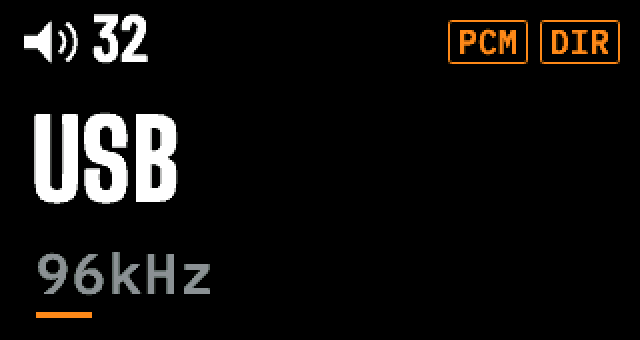
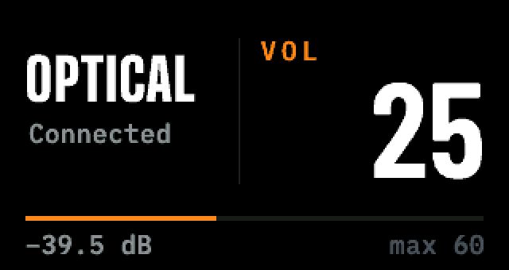
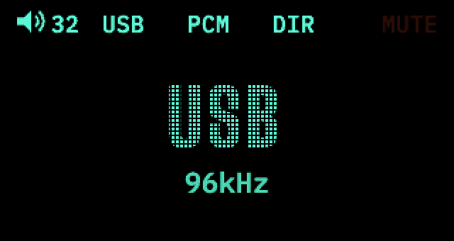
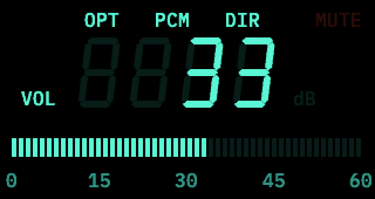

# SMSL AO300 custom firmware

Unofficial replacement firmware for the control chip (STC8C2K64S2) of the SMSL AO300
amplifier. It is SMSL's own firmware v1.4 with patches applied: everything the amp does
stays, and the changes below are added. You build it on your own computer from SMSL's
updater, which you download yourself. No SMSL firmware is in this repository.

| | Home | Volume |
|---|---|---|
| House Numerals |  |  |
| Phosphor Panel |  |  |

The screens are rendered by the emulator from the built images, at twice the panel's size.

## What it adds

- **A new look for the display**, in two styles. House Numerals has large, clean numerals and
  a volume page that slides in. Phosphor Panel imitates a vacuum fluorescent display: a
  dot-matrix input name, a row of lamps and seven-segment digits. Both follow the amp's COLOR
  setting. The menus stay as they are.
- **A volume cap at power-on.** The amp starts no louder than a level you choose, one for
  speakers and one for headphones (stock comes back at the volume it was left at). The volume
  keys are not limited.
- **No pop** from the volume keys on Optical and Coaxial without a signal, and none when an
  input is chosen in the menu.
- **The display's Auto OFF works after power-on.** Stock leaves the display lit until the
  first key press; SMSL fixed this only on the AO300 PRO.
- **Infrared commands for programmable remotes and home automation**: one per input, power
  on and power off. An input command also wakes the amp from standby, on that input.
- **A corrected status text**: "Disconnected" instead of "No Connected" on HDMI ARC.

The installer asks for three things: the look, the two volume caps, and whether an input
command may wake the amp from standby. The RESET menu page shows which firmware is running:
`v1.4 tbenr` followed by a build tag.

## Read this first

- **No warranty.** This is a hobby project, provided as it is, with no warranty of any kind.
  You use it at your own risk. See [LICENSE](LICENSE).
- **It can do harm.** The firmware controls the volume, the mutes and the power sequence of a
  mains-powered amplifier. A fault could damage the amplifier or your speakers, or play at
  full volume. Turn the volume down, or disconnect the speakers and take off your headphones,
  the first time you power the amp after flashing.
- **Warranty.** Flashing goes over the amp's own USB-C socket with a regular USB cable, the
  way SMSL's updater does it; nothing is opened or soldered. Replacing the firmware may still
  void SMSL's warranty.
- **Not affiliated.** This project is not affiliated with, authorised or endorsed by SMSL or
  by STC. Their names and product names are trademarks of their owners and are used only to
  say what the firmware runs on.
- **No vendor firmware here.** The firmware is SMSL's and is not distributed with this
  project in any form. The installer builds your image from the updater you download from
  SMSL. Everything built from that file, including the Windows updater the installer can
  make, is for your own amplifier only: do not share or publish it.

## Supported hardware

The SMSL AO300 running firmware v1.4 (SMSL's updater `SMSL_AO300_UPDATE_VER0A5_EN`). The
AO300 PRO has different firmware and is not supported. The flasher reads the chip first and
refuses to write unless it reports what a factory AO300 reports.

## Install

You need a Mac or a Linux computer with Python 3.8 or newer, a USB-C data cable and the
amp's remote.

1. Clone this repository, or download it as a ZIP and unzip it.
2. Download SMSL's updater for firmware v1.4 from SMSL's support pages and put it in the
   `original` folder.
3. Connect the amp's USB-C socket to the computer and run `./install.sh`. It asks its
   questions and builds your image.
4. Choose **Flash**, then put the amp in standby and press Source on the remote.

[docs/install.md](docs/install.md) is the full guide, including Windows and what to do when
something goes wrong.

## Safety and recovery

Nothing is written before you choose Flash, and the flasher checks the chip before it erases
anything. The chip's bootloader is in ROM and cannot be overwritten: if a flash fails, or a
build misbehaves, unplug the amp, start the installer's "Restore the stock firmware" and plug
the amp back in. A cold power-up always reaches the bootloader. Keep SMSL's updater file: the
firmware cannot be read back from the chip, so that file is your only copy of stock.

## Infrared commands

Eight NEC commands, sent with the stock remote's address bytes 0x12 0x34:

| Command | Does |
|---|---|
| 0x10 | input 1, USB audio |
| 0x11 | input 2, Optical |
| 0x12 | input 3, Coaxial |
| 0x13 | input 4, Bluetooth |
| 0x14 | input 5, HDMI (ARC) |
| 0x15 | input 6, AUX IN |
| 0x16 | power on (ignored when the amp is on) |
| 0x17 | power off (ignored in standby) |

- With the amp on, an input command acts on the home screen and is ignored on a menu page. A
  command for the input already selected is ignored, so repeating it does not interrupt the
  audio.
- In standby an input command powers the amp on, on that input, so one command reaches "on,
  playing HDMI" from any state. The installer can turn this off; the amp then wakes only on
  0x16 or the Power key.
- 0x16 and 0x17 set the power state instead of toggling it, for a controller that gets
  nothing back from the amp. 0x17 also works from a menu page.
- Every other command behaves as in stock. `features/direct-select/README.md` in the
  repository has the details.

## Status

This firmware runs on the author's amplifier: House Numerals `hn19` since 2026-11-14, and
Phosphor Panel `pp2` for the month before it. The current Phosphor Panel build (`pp4`) adds
only the power and wake commands to `pp2`; it is tested in the emulator and has not been on
an amp. Flashing has been done from macOS and from Linux. The Windows route has not been
used to flash. [docs/status.md](docs/status.md) lists what was verified on hardware and when.

## For developers

Each change is a small binary patch on the stock image, written in 8051 assembly through
Python build scripts and tested in an emulator that runs the whole firmware. These files are
in the repository, https://github.com/tbenr/smsl-ao300-firmware; a release package carries
only what the installer needs.

| Topic | Where |
|---|---|
| Setting up, building, testing, flashing by hand | [docs/development.md](docs/development.md) |
| Rules for changing anything, for people and for coding agents | [AGENTS.md](AGENTS.md) |
| What the MCU talks to, the volume scale, the memory budget | [docs/hardware.md](docs/hardware.md) |
| Registers and pins, traced in the emulator and read back from the amp | [docs/bus-map.md](docs/bus-map.md) |
| What is not known yet, and the plan for finding out | [docs/open-questions.md](docs/open-questions.md), [docs/probing-plan.md](docs/probing-plan.md) |
| The stock menu's internals | [docs/menu-system.md](docs/menu-system.md) |
| The theme kit and the design mock | [docs/ui-kit.md](docs/ui-kit.md), [features/ui-theme](features/ui-theme/README.md) |
| How each feature works | `features/<name>/README.md` |

Features that no installer image contains: [auto-switch](features/auto-switch/README.md)
(experimental: to HDMI when the TV comes on), [probe](features/probe/README.md) (a read-only
register dump for research) and the notes on a stock display bug,
[status-line-flicker](features/status-line-flicker/NOTES.md).

## Licence

The project's own code and documentation are under the [MIT licence](LICENSE). The fonts the
themes draw with are under the SIL Open Font License, and SMSL's firmware is not part of this
project at all: [NOTICE.md](NOTICE.md) has the details.
